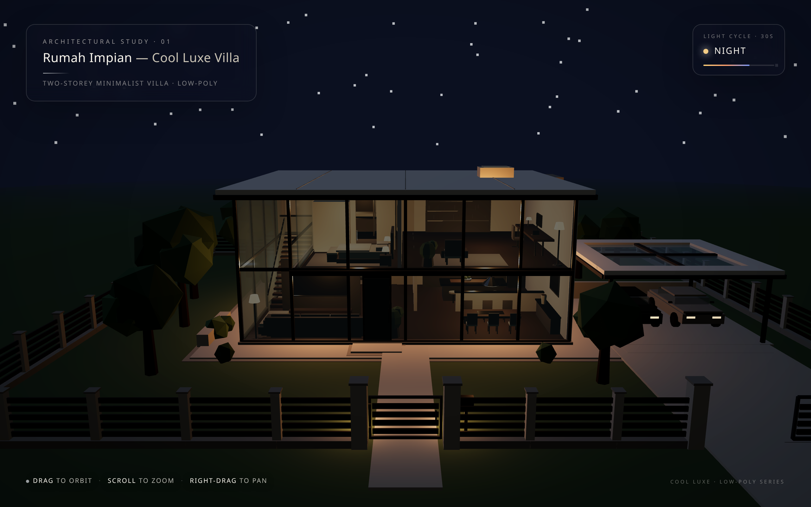
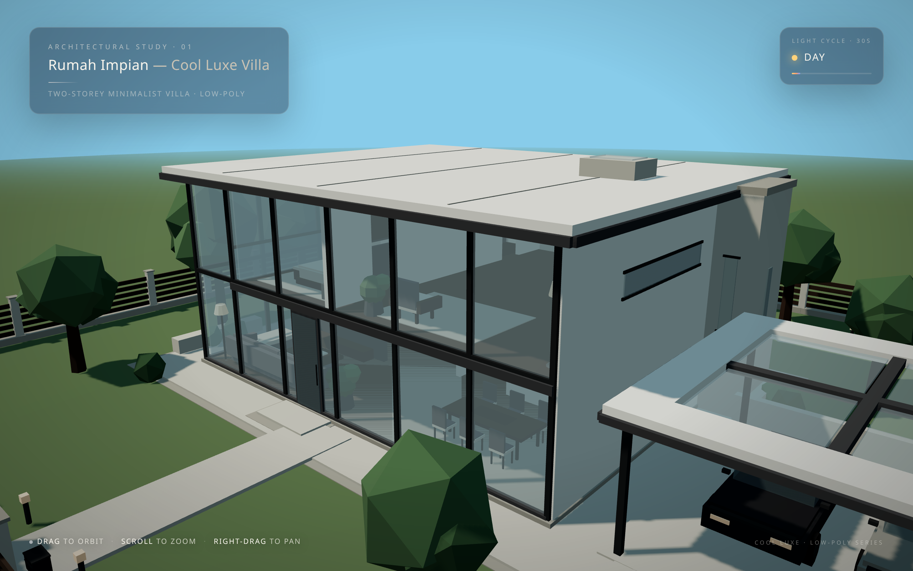
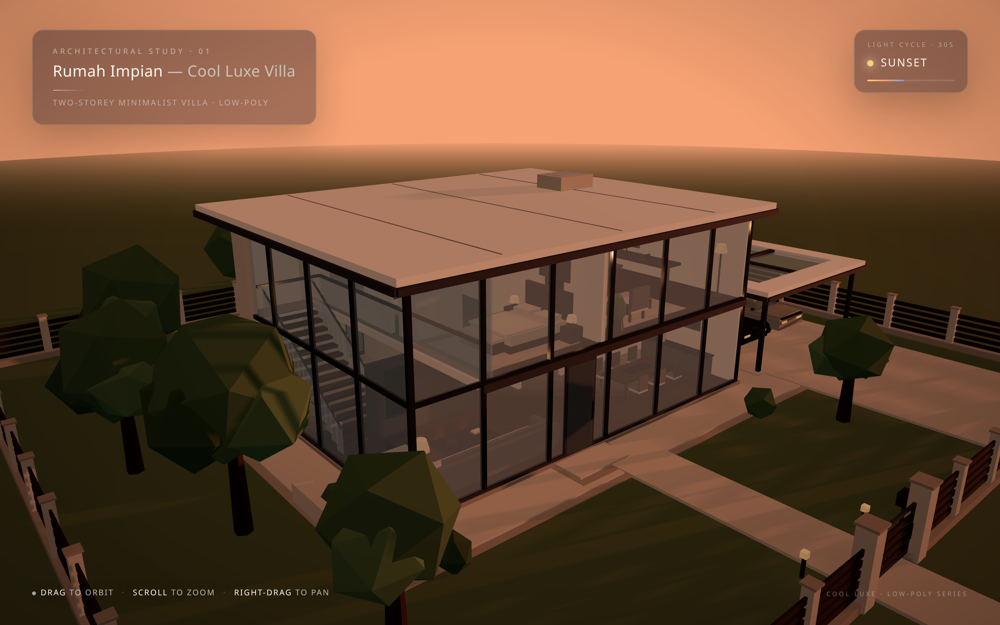
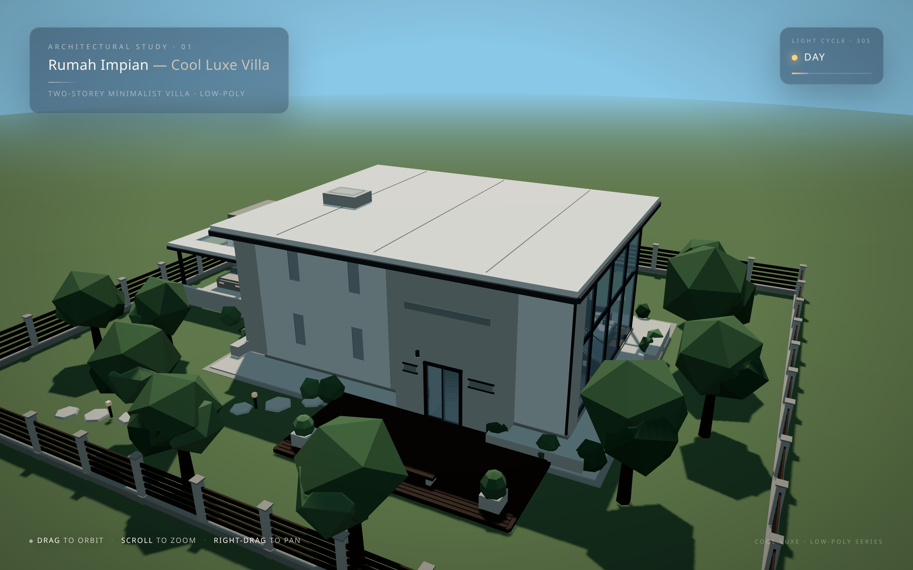

# Rumah Impian — Cool Luxe Villa

An interactive, low-poly **two-storey minimalist villa** rendered in real time with [Three.js](https://threejs.org/). A single self-contained HTML file — no build step, no bundler, no local dependencies.

The villa sits on a fenced plot with a glazed carport and two cars, a floating walnut staircase behind a full-height glass facade, a furnished interior (living, dining, kitchen, bedroom, bathroom, office), a rear timber deck with a garden path, and a **30-second day → sunset → night light cycle** that drives the sky gradient, sun position, shadows, interior lights, window glow and stars.



## Preview

| Day | Sunset |
| --- | --- |
|  |  |

| Rear elevation | Interior / night |
| --- | --- |
|  |  |

## Live demo

GitHub Pages: **https://ikyletwar.github.io/cool-luxe-villa/**

## Controls

| Input | Action |
| --- | --- |
| **Drag** (left button) | Orbit the camera |
| **Scroll** | Zoom in / out |
| **Right-drag** | Pan |

## Features

- **Real-time light cycle** — a 30 s loop interpolates between keyframed sky colours and animates the sun along an arc. `Sunset` and `Night` phases fade in the moon fill, interior point lights, path lights, emissive bulbs, additive window glow and a star field.
- **Physically-flavoured lighting** — hemisphere + ambient + directional sun with a 2048² PCF soft shadow map, ACES Filmic tone mapping, sRGB output.
- **Procedural geometry only** — every object is built from `BoxGeometry`, `CylinderGeometry`, `SphereGeometry`, `LatheGeometry` (the freestanding tub) and `IcosahedronGeometry` (trees / shrubs). No textures, no external models.
- **Instancing for repetition** — books, deck slats, stepping stones, fence posts/slats, tree trunks and canopies use `InstancedMesh`, with geometry caching (`boxGeo`/`cylCache`) to keep draw calls and allocations low.
- **Responsive HUD** — a glassmorphic title card plus a live phase indicator (Day / Sunset / Night) and light-cycle progress bar, driven by `requestAnimationFrame`.

## Project structure

```
cool-luxe-villa/
├── index.html            # The site — everything (HTML + CSS + ES module) in one file
├── test.html             # Dev harness: error overlay, camera URL params, still-frame capture
├── docs/                 # Preview renders used by this README
│   ├── preview-day.png
│   ├── preview-sunset.png
│   ├── preview-night.png
│   └── preview-rear.png
└── README.md
```

## Running locally

`index.html` uses an ES-module import map, so it must be served over HTTP (opening it via `file://` works in Chromium but may be blocked elsewhere).

```bash
# from the project root
python3 -m http.server 8080
# then open http://localhost:8080/index.html
```

Or with Node:

```bash
npx serve .
```

Three.js r160 (`three` and `three/addons/`) is pulled from the unpkg CDN via the import map in `index.html`. An internet connection is required on first load.

## `test.html` — dev harness

The development copy adds tooling used to produce the renders above:

- An on-page overlay that surfaces `error`, `unhandledrejection`, `console.error` and `console.warn` output.
- Camera presets via query string: `?cam=west|front|rear|top|close|southwest|gate|door`.
- A still-frame mode: `?still=1&t=0.42` freezes the light cycle at a given phase (`0…1`) and renders one frame — handy for screenshots.

Example:

```
http://localhost:8080/test.html?still=1&t=0.65&cam=front
```

## Browser support

Any browser with WebGL 2 and ES-module import-map support — current Chrome, Edge, Firefox and Safari.

## License

No license file is included. All rights reserved by the author unless one is added.
